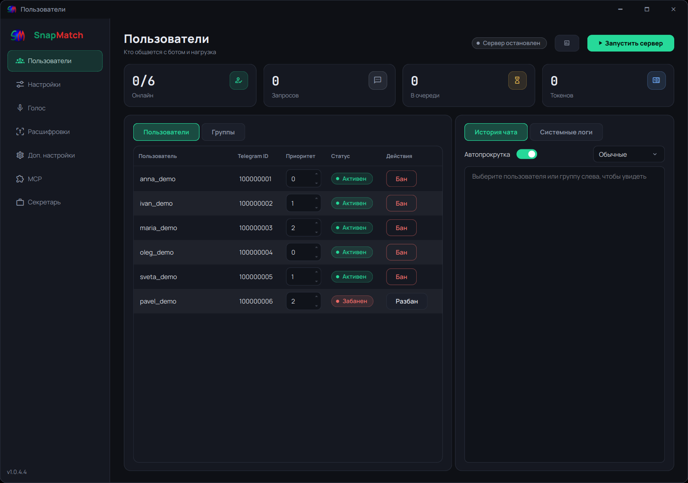
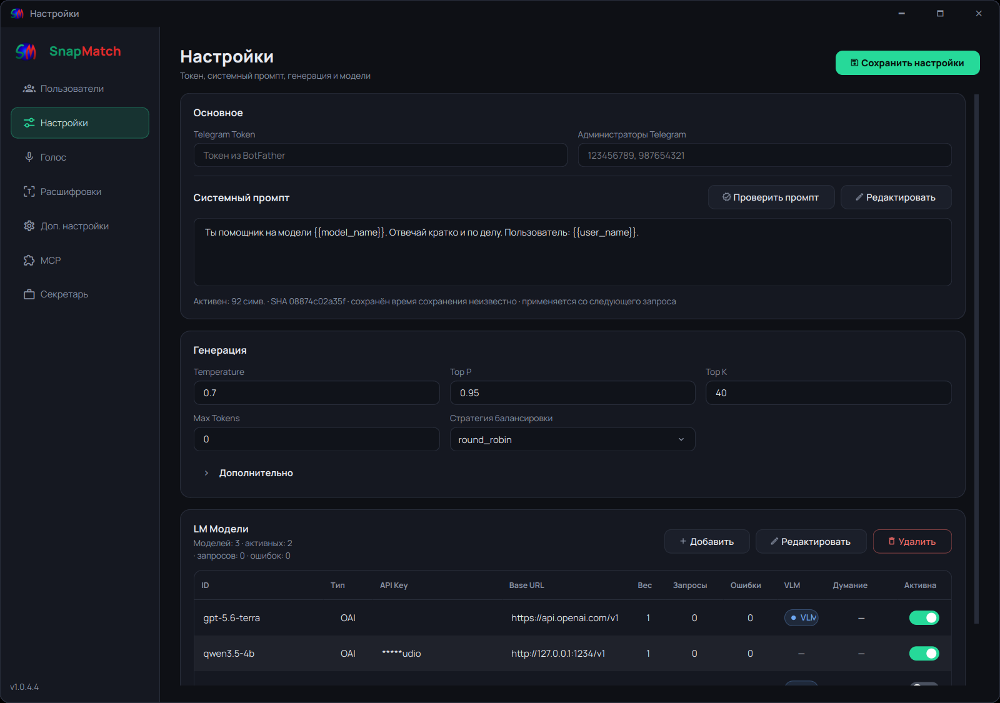
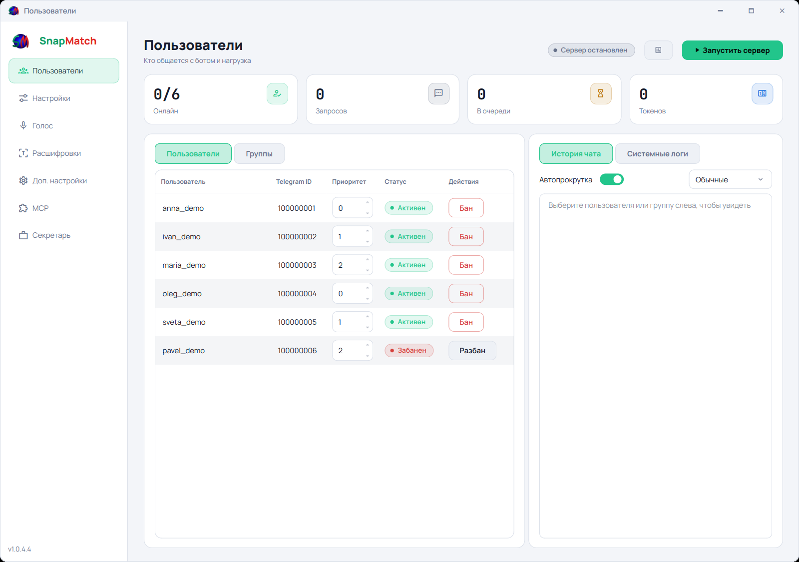
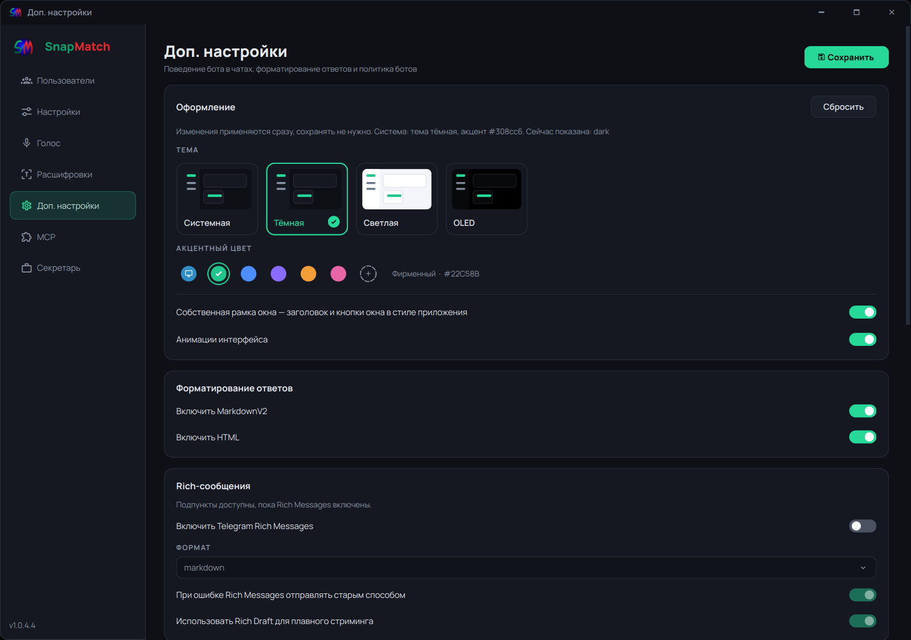
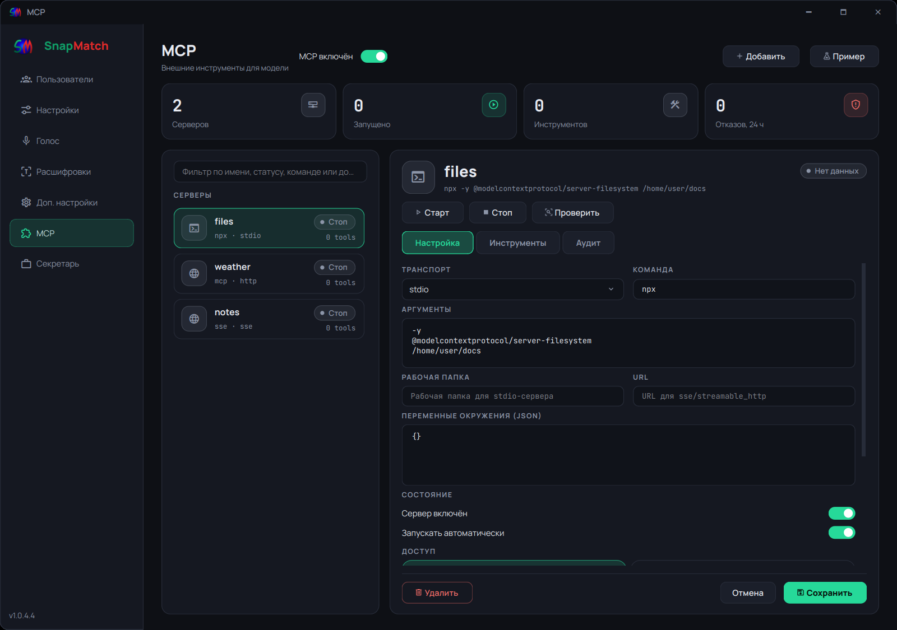
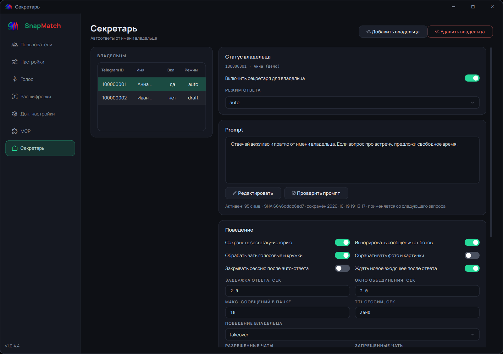
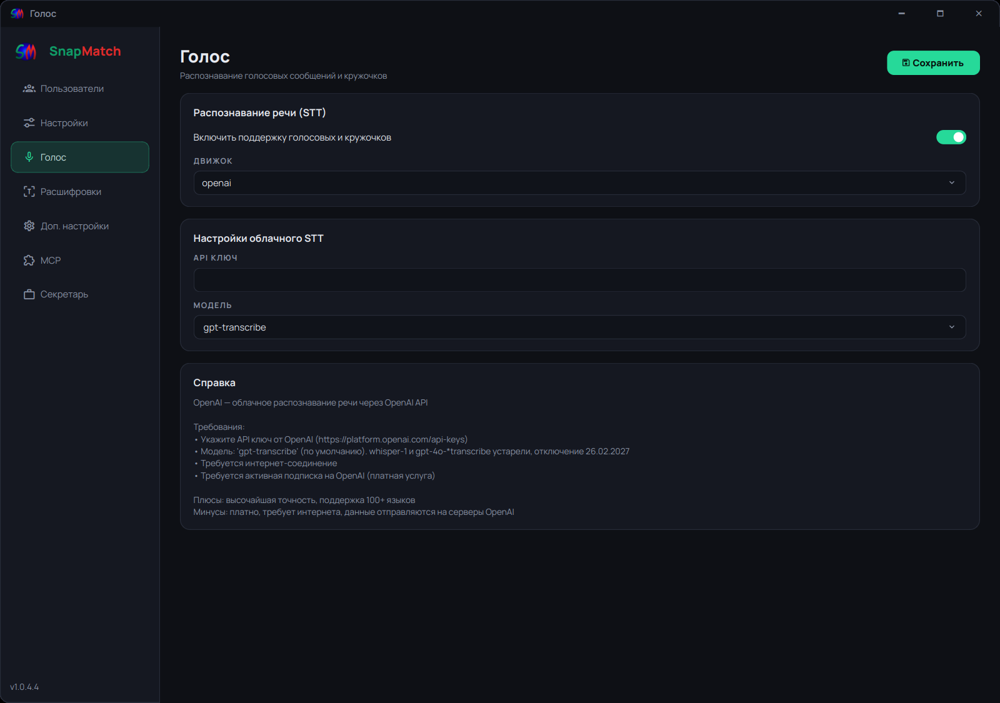
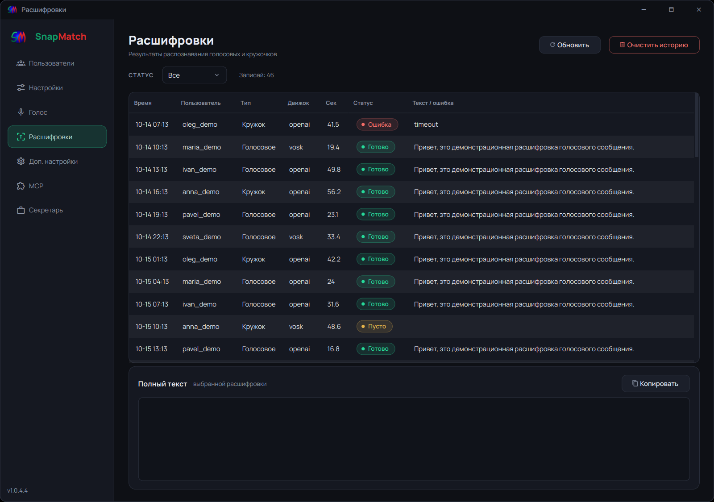
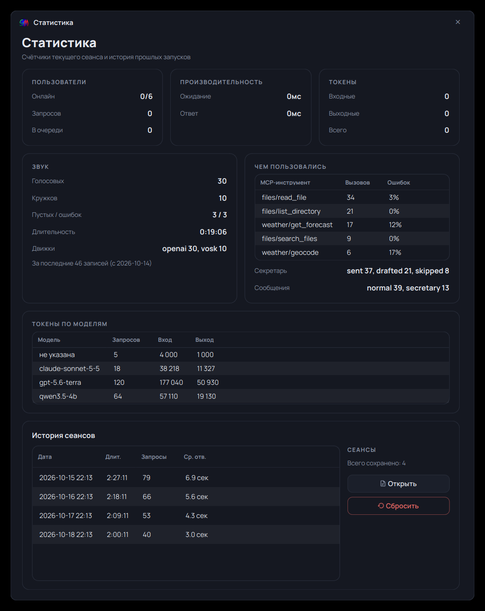
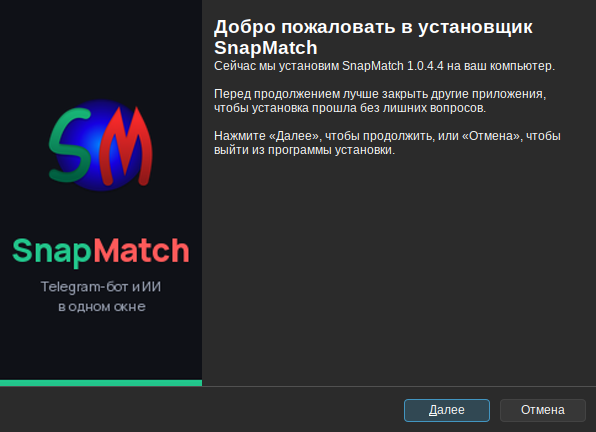

# SnapMatch

SnapMatch - desktop-приложение для управления Telegram-ботом с AI-моделями, MCP-инструментами, голосовой обработкой, историей сообщений и режимом секретаря.

Версия 1.0.5.0: полностью новый интерфейс (тёмная, светлая, OLED и системная темы, акцент, собственная рамка окна, собственные диалоги и подсказки), статистика по звуку, использованию и моделям, обновлённый установщик Windows (подробнее в [CHANGELOG](CHANGELOG.md)). Голосовое распознавание через облачные и совместимые API работает в обычной сборке; локальный Vosk необязателен и ставится отдельно (`requirements-local-stt.txt`).



## Возможности

- подключение Telegram-бота через токен BotFather;
- несколько AI-моделей и стратегии распределения запросов между ними;
- OpenAI-compatible API, OpenRouter, Groq и локальные совместимые endpoints;
- MCP-серверы, discovery tools и настройка доступа к инструментам;
- режим секретаря для обработки входящих сообщений и подготовки ответов;
- обработка голосовых сообщений через Vosk, OpenAI Whisper или Groq;
- GUI-панель администратора на PyQt6: светлая, тёмная, OLED и системная темы, настраиваемый акцент;
- статистика сеанса, звука, использования MCP и токенов по моделям;
- сборка Windows `.exe` через PyInstaller;
- Windows-установщик через Inno Setup (светлая и тёмная тема);
- Debian/Ubuntu `.deb` через Linux build workflow.

## Быстрый старт из исходников

```bat
python -m venv .venv
.venv\Scripts\activate
pip install -r requirements.txt
python main.py
```

Для сборки `.exe` / `.deb` используйте `requirements-build.txt` (то же самое плюс PyInstaller).

После запуска откройте вкладку настроек, укажите Telegram token, добавьте модель и сохраните конфигурацию.

## Документация

- [Список изменений](CHANGELOG.md)
- [Что нового в 1.0.5.0](RELEASE_NOTES_1.0.5.0.md)
- [Что изменилось в 1.0.4.3](docs/RELEASE_1.0.4.3.md)
- [Использование приложения](docs/USAGE.md)
- [Сборка и релиз](docs/BUILD_AND_RELEASE.md)
- [Пример MCP-сервера](examples/mcp/README.md)

## Скриншоты

### Настройки



### Светлая тема



### Оформление



### MCP



### Секретарь



### Голос и расшифровки





### Статистика



### Установщик Windows



## Сборка

Windows:

```bat
build.bat
```

Для отдельной локальной Vosk-сборки используйте `build_vosk.bat` после добавления модели и FFmpeg.

Linux:

```sh
bash build_linux.sh
```

Обычный Windows installer не включает Vosk и FFmpeg. Для локального распознавания есть отдельный `build_vosk.bat`, которому нужны модель Vosk и FFmpeg. Linux `.deb` собирается в GitHub Actions на Ubuntu 24.04; `ffmpeg` нужен только для локального Vosk. Ручной запуск GUI на отдельной Linux-машине пока не проверялся. Подробности: [docs/BUILD_AND_RELEASE.md](docs/BUILD_AND_RELEASE.md).

## Данные и локальные файлы

SnapMatch хранит рабочие данные локально: настройки, базу сообщений, временные загрузки, историю и модели распознавания речи. Эти файлы не входят в репозиторий, потому что зависят от конкретной установки и могут содержать приватную информацию.

При первом запуске приложение создаёт локальный `config.json`. Для ориентира в репозитории есть безопасный `config.example.json` без токенов и API-ключей.

## Связь

Обсудить проект, задать вопрос или связаться напрямую можно в Telegram-группе: [C0BETKA](https://t.me/C0BETKA).

## Благодарности

Спасибо Павлу Дурову и команде Telegram за открытую Bot API-экосистему. Благодаря ей независимые разработчики могут создавать такие инструменты, интеграции и пользовательские сценарии вокруг Telegram.

## Лицензия

Проект распространяется под GPL-3.0. Текст лицензии находится в [LICENSE](LICENSE).
